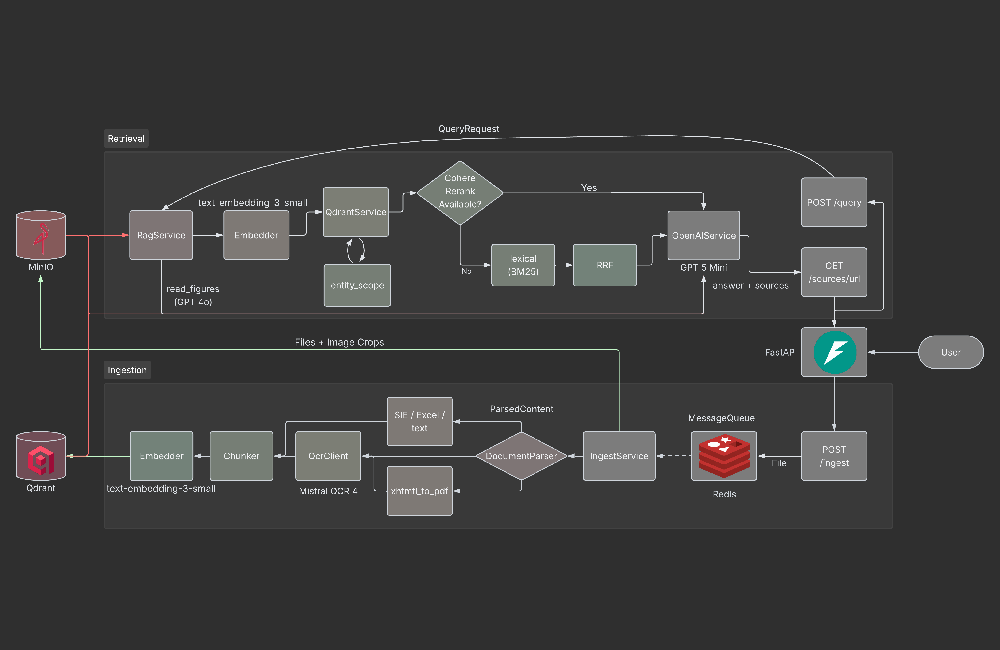

# Financial RAG Pipeline

Multimodal RAG for Financial documents. FastAPI accepts uploads and questions; Qdrant
stores chunks; MinIO holds originals and figure crops. Parsing uses Mistral OCR 4
(Azure AI Foundry) where needed, OpenAI for embeddings / vision / answers, and
optional Cohere Rerank.

This repo is an **HTTP API**. Connect any frontend to the REST surface; see
[docs/api_guide.md](docs/api_guide.md) for endpoints and DTOs.



## Prerequisites

- Python 3.11+
- Docker and Docker Compose
- OpenAI API key
- Azure AI Foundry deployment of Mistral OCR 4 (PDF / Office / image / XHTML ingest)
- Optional: Cohere Rerank on Azure AI Foundry
- Optional: Chrome or Edge on the API host (Bolagsverket `.xhtml` print-to-PDF)

## Quick start

```bash
# 1. Start infrastructure (Qdrant, MinIO, Redis)
docker compose up -d qdrant minio minio-init redis

# 2. Create a virtualenv and install the package
python -m venv .venv
# Windows: .venv\Scripts\activate
# macOS/Linux: source .venv/bin/activate
pip install -e ".[dev]"

# 3. Configure environment
cp .env.example .env
# Set OPENAI_API_KEY and MISTRAL_OCR_ENDPOINT / MISTRAL_OCR_API_KEY
# Optional: COHERE_API_BASE / COHERE_API_KEY for reranking

# 4. Initialize the Qdrant collection (idempotent)
python -m app.scripts.init_qdrant

# 5. Run the API
uvicorn app.main:app --reload
```

- OpenAPI UI: http://localhost:8000/docs
- Health: http://localhost:8000/health

When the API runs inside Docker (or any host the browser cannot resolve as
`minio:9000`), set `MINIO_PUBLIC_ENDPOINT` to a hostname the client can reach.
Presigned source URLs are signed against that host.

## Endpoints

| Method | Path | Description |
|--------|------|-------------|
| GET | `/health` | Qdrant + MinIO ping |
| POST | `/ingest` | Accept upload → `202` + `job_id` (worker continues) |
| GET | `/ingest/jobs/{job_id}` | Poll job (`queued` / `running` / `completed` / `duplicate` / `failed` / `needs_metadata`) |
| PATCH | `/ingest/jobs/{job_id}/metadata` | Fill gaps and re-queue a `needs_metadata` job |
| POST | `/query` | RAG question → answer, sources, retrieval trace |
| GET | `/sources/url` | Presigned MinIO URL for a cited `object_key` |

Full request/response shapes, enums, polling, chat history, and citation deep-links:
[docs/api_guide.md](docs/api_guide.md).

## Ingest

`POST /ingest` is `multipart/form-data`: `file` + `tenant_id`, plus optional
`company_name`, `doc_type`, `category`, `year`, `quarter`, `language`. Work runs
in a lifespan worker over a Redis job-id queue. Poll
`GET /ingest/jobs/{job_id}` until a terminal status.

```bash
curl -X POST "http://localhost:8000/ingest" \
  -F "file=@q3_report_2024.pdf" \
  -F "tenant_id=default_tenant_test_corp_123" \
  -F "company_name=SME Corp AB" \
  -F "doc_type=financial_report" \
  -F "category=financing" \
  -F "year=2024" \
  -F "quarter=3"
# → {"job_id":"...","status":"queued"}

curl "http://localhost:8000/ingest/jobs/<job_id>"
```

- Documents are identified by a **sha256 of the bytes**, not the filename. Same
  content for the same tenant → `status="duplicate"` (no second parse).
- Metadata may be omitted on upload; OCR / local parsers fill what they can
  (SIE defaults `language=sv` and often `company_name` / `year`). If required
  fields are still blank after parse, the job pauses as `needs_metadata`
  (MinIO object kept). Supply fields with `PATCH /ingest/jobs/{job_id}/metadata`
  and keep polling — do not re-upload.
- Job payloads live in API process memory; an API restart drops in-flight jobs
  (re-upload). Completed documents remain in MinIO and Qdrant.

Supported types and how they become Markdown:
[docs/document_formats.md](docs/document_formats.md).

## Query

```bash
curl -X POST "http://localhost:8000/query" \
  -H "Content-Type: application/json" \
  -d '{
    "question": "What was Q3 revenue?",
    "tenant_id": "default_tenant_test_corp_123",
    "doc_type": "financial_report",
    "category": "financing",
    "year": 2024,
    "quarter": 3,
    "top_k": 5,
    "expand_neighbors": false,
    "rerank": true,
    "chat_history": []
  }'
```

Response: `answer`, `sources` (chunk text + `ChunkMetadata`), and `trace`
(filters, hit ranks, fusion method, timings, optional figure readings).

- `tenant_id` is required. There is **no authentication** yet — isolation is only
  as strong as the id the client sends.
- Optional filters (`company_name`, `doc_type`, `category`, `year`, `quarter`)
  become hard Qdrant `must` clauses. Leave `company_name` empty to let retrieval
  infer entity scope from the question and prior user turns.
- Send prior turns as `chat_history` (`role` + `content`). The server does not
  store sessions; assistant `content` should be the answer text only.
- Open a citation with `GET /sources/url?object_key=…&tenant_id=…`, then `GET`
  the presigned URL (append `#page=N` for PDFs in the browser). File bytes are
  never proxied through the API.

Retrieval map: [docs/rag_strategy.md](docs/rag_strategy.md).

## Reranking (optional)

When `COHERE_API_BASE` and `COHERE_API_KEY` are set, `/query` retrieves
`top_k × RERANK_CANDIDATE_MULTIPLIER` candidates, scores them with Cohere, and
keeps the top `top_k` in Cohere order. BM25 / RRF still appear on the trace but
do not override that order. If Cohere is unset or fails, the query continues
with vector+BM25 fusion and records the reason on `trace.rerank`.

`COHERE_RERANK_MODEL` must match the Foundry deployment name exactly.

## Development

```bash
pytest
ruff check .
```

The suite needs neither Docker services nor real API keys — externals are faked
and HTTP is mocked.

Pinned lock-style install (optional): `pip install -r requirements.txt` after
or instead of the editable install, depending on how you prefer to freeze deps.

## Documentation

| Doc | Contents |
|-----|----------|
| [docs/api_guide.md](docs/api_guide.md) | REST + DTOs for frontend teams |
| [docs/architecture.md](docs/architecture.md) | Stack and system shape |
| [docs/ingestion_pipeline.md](docs/ingestion_pipeline.md) | Upload → chunks in Qdrant |
| [docs/document_formats.md](docs/document_formats.md) | Per-format parsing |
| [docs/rag_strategy.md](docs/rag_strategy.md) | Question → answer |
| [docs/ranking.md](docs/ranking.md) | Recall, BM25, RRF, Cohere, entity scope |
| [docs/answering.md](docs/answering.md) | Neighbours, vision, generation, sources |
| [docs/operations.md](docs/operations.md) | Failure modes, gaps, local ops |
